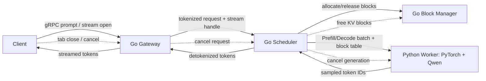

# llm_inference_server

Hi! This is my LLM Inference Server Project. The goal is to build a system where I can input prompts into a language model on a GPU, streaming tokens back. The whole point of streaming is to improve **Perceived Latency** and, therefore, user experience and retainment. 

## Why does it matter? What am I trying to learn through this project? 
- **Batching**: Batching involves grouping my inference requests into a single unit so that GPU can process them in parallel. GPUs are massively parallel processors. If we just send a single request, we are wasting the potential of this parallel computing by letting the vast majority of the cores unused! This project compares a benchmark naive, static batching and continuous batching. 

- **Latency vs. Throughput Trade-off**: To generate even a single token, GPU has to load the entire model's weights from VRAM -> processing cores. Batching requests together meaning GPU loads the model weights only once, but applies them simultaneously to all requests in the batch (as opposed to loading weight for every single requests). The problem with batching is that you would have to wait for the batch to form (queueing latency) and wait for the model to run on all the requests in the batch (queueing latency) before outputting the answer, hence worsen latency.

## My architecture at a glance

Prefill vs. Decode: 
- Prefill: From a user's perspective, prefill is the wait between sending a prompt and seeing the first token. Under the hood, the worker receives the prompt token IDs and the assigned block table. It then passes the entire prompt through the LLM and write those tokens' key-value tensors into the assigned physical GPU blocks. 

- Decode: Generates the **response** token one at a time. Using the cached state (aka the stored k-v tensors), it produces a token and repeatedly decode with the new token (+ previous tokens from the KV cache) each time until the response is complete.

# Architecture Diagram

## Design decisions

# Why the Go + Python split?
- Python is the best ecosystem for PyTorch/Transformers/CUDA
- Go because it is a strong fit for gRPC networking and overall request orchestration

# Why static/continuous matching?

In static batching, my scheduler waits for a fixed number of requests (e.g., batch size of 16) to arrive before sending them to the GPU worker.

In continuous matching, if a request finishes early, its slot in the batch is immediately free and the scheduler can inject a new request.

Static batching is easy to get started with because that is the traditional batch processing in deep learning. But every high-performance inference engine today relies on continuous batching, so I want to compare these two techniques.

## KV strategy
- As of right now (17th Oct 2026), we are using a per-request KV cache so that we can simply validate the control flow. Not implemented yet: true paged KV/block manager-backed physical allocation for memory-efficiency optimisation.

## Observability
- Prometheus as the time-series database. It scrapes metrics from my LLM inference  workers, but it's monitoring screens is not the best. 
- Grafana as our visualisation layer,  treating Prometheus as its data source.

## Benchmark methodology: 
- Hardware/model: Google Colab NVIDIA T4 (yes, I'm broke). Qwen/Qwen2.5-0.5B-Instruct. 
- Traffic model: Poisson arrivals at configured rate(e.g., 0.2 req/s) over a 60s arrival window.
- Controls held constant: same model, GPY, seed(1), warm-up (1 request), output-length mix (32/64/128 max tokens)
- Compared configs:
    - Naive: batch size 1: wait 0s
    - Static: max batch size 4, collection wait 50ms
